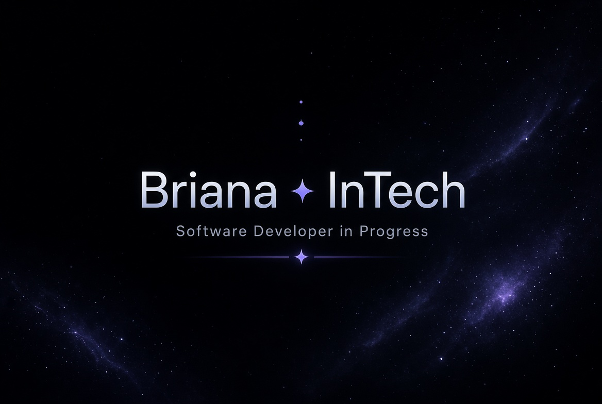

 

 

---

### 👋 About Me

I'm a Computer Science student and aspiring software developer interested in building practical digital products and solving real-world problems through technology.

I'm developing my skills in frontend engineering while expanding my understanding of backend development and full-stack systems. I enjoy turning ideas into projects, exploring how applications work behind the scenes, and learning through hands-on practice.

My current focus is strengthening my JavaScript fundamentals, building useful projects, and developing the technical and problem-solving skills needed to contribute to real-world software.

I'm open to learning opportunities, internships, SIWES placements, collaborative projects, and mentorship as I continue growing as a developer.

---

### 🛠️ Tech Stack

**Languages & Web Technologies**

**Exploring & Tools**

> These are technologies I'm currently learning and working with — not a claim of equal proficiency across all of them.

---

### 🚀 Projects

| Project | Description | Stack | Status |
|---------|-------------|-------|--------|
| **LifeOS** | Personal productivity and life-management app that brings tasks, goals, habits, ideas, and progress into one place. | HTML, Tailwind CSS, JavaScript, LocalStorage | In Development |
| **Developer Portfolio** | Personal portfolio and project showcase — a home for projects, skills, and progress as a developer. | TBD | Planned / In Progress |

---

### 🎓 Education

- **Miva Open University** — Computer Science  
  *400 Level, First Semester*

---

### 💡 Engineering Interests

- Frontend development & responsive interfaces
- Full-stack software engineering
- Backend development & APIs
- Practical problem-solving through software
- Building useful digital products
- SIWES and internship opportunities
- Freelance projects and collaborative development

---

### 📊 GitHub Stats

---

### 🤝 Let's Connect

I'm always interested in learning, building useful products, and collaborating on meaningful projects.

💼 Open to internships, SIWES placements, collaborative projects, and mentorship.

---

⭐ From **Briana ✦ InTech** | Built with vision and lots of 🖤 

